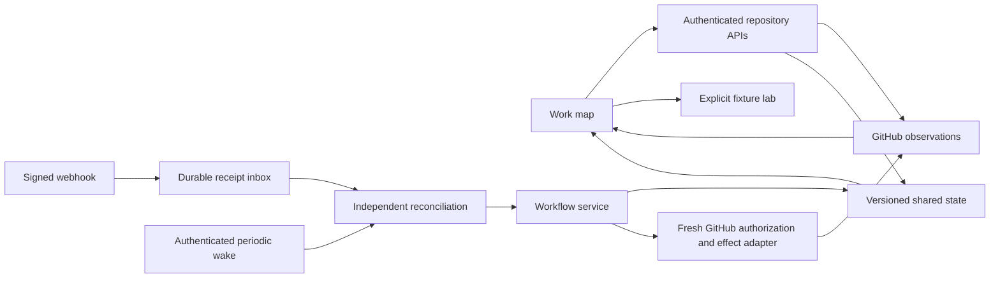

# Architecture and implementation decisions

## Connected repository automation

Repository discovery is stored in the provider-neutral automation registry, separate from per-repository workflow authority. Enrollment registers discovery before committing enabled intent. Signed receipts, the bounded registry/inbox cursors and the protected scheduler use that state; connecting alone does not enroll or release reviews. See [the automation contract](automation.md).

This document describes current code and its verification boundaries. The [original technical structure](product-plan.md#7-proposed-technical-structure) remains a historical proposal; later decisions selected vinext and Cloudflare, with provider-neutral workflow/state modules and Node/Vercel build targets. Product rules remain in [progressive-review.md](progressive-review.md), and scope is tracked in [roadmap.md](roadmap.md).

The [scoped live pilot](pilot.md) verified one public A → B → C chain, one human reviewer, hosted SQLite plans, release before merge, holds, comment preservation, reapproval, background progression and cascade rollback. Five webhook deliveries returned HTTP 500, including two after the native-entry mitigation; their cause remains unresolved. Automatic progression and global GitHub workflow writes were disabled after the pilot. Source implementation, passing local tests and successful pilot effects do not establish broader production readiness or reliable webhook acceptance.

## Current component map

| Responsibility | Current implementation | Boundary |
| --- | --- | --- |
| Graph interface | [App](../src/App.tsx), [map canvas](../src/components/WorkMap.tsx), [details](../src/components/DetailPanel.tsx), [reviewer picker](../src/components/ReviewerPicker.tsx) | Continuous interactive map; connected plans/settings and explicit release preview; simulation remains in the separate lab |
| Normalized graph | [Domain types](../src/domain/types.ts), [map layout](../src/domain/map-layout.ts), [GitHub reader](../src/server/github.ts), [workflow topology](../src/workflow/topology.ts) | All-author open PRs and bounded merged ancestry; observed/declared parent provenance; automatic progression supports reliable simple chains |
| Lab workflow | [Fixture command engine](../src/domain/engine.ts) | Client-local mock interactions; no GitHub writes |
| Connected workflow | [Reducer](../src/workflow/engine.ts), [service](../src/workflow/service.ts), [GitHub adapter](../src/server/workflow-github.ts) | Durable enrollment, holds, approval minima, generations, claims, release/rollback and recovery; real effects remain operator/scope/permission gated |
| Coordination state | [Typed store](../src/server/state/types.ts), [SQLite object](../src/server/plan-object.ts), [PostgreSQL adapter](../src/server/state/postgres.ts) | Shared versioned plans, workflow intent, actions, inbox and actor history; hosted pilot uses SQLite, PostgreSQL is verified locally with fake effects |
| Authentication and execution | [Auth](../src/server/auth.ts), [API routes](../app/api), [App principal](../src/server/github-app.ts), [background runner](../src/server/workflow-background.ts) | Public sign-in with fresh numeric identity/repository checks; independent installation-token execution for explicitly managed work |
| Webhook ingress | [Shared receipt](../src/server/webhook-receipt.ts), [native Cloudflare adapter](../src/server/webhook-native.ts), [Worker](../src/worker.ts) | HMAC, body bound, exact repository scope and durable ACK; receipt queues reconciliation without executing workflow effects |
| Signals and reviewer context | Reviewer load, request-age UI and GitHub suggested reviewers | Loaded-repository planned/active counts; seven-day sent history unavailable; source-derived areas/ownership/continuity remain proposed |

GitHub owns lifecycle, reviews and actual requests. merge.foo owns planned assignments, holds, declared dependencies, approval minima, management intent and automation history. Saving plans or importing a graph does not activate automation. The read-only reader is separate from the effect adapter; a rendered read snapshot is not sufficient release authority.

## Framework and hosting

vinext/React/Vite supply the application and framework routes. The Cloudflare build uses the generated legacy Vite/Wrangler integration and explicit `wrangler.jsonc`; optional caches, image optimization, KV and D1 are off. The current deployment uses the existing `merge-foo` workers.dev Worker. No DNS or paid-plan change was part of the pilot. Exact dependencies are recorded in `pnpm-lock.yaml`.

The subsequent user-authorized domain cutover connected `https://merge.foo` to that same Worker. Its native entry redirects trusted browser aliases before framework/auth cookies; shared auth handlers also enforce canonical login/callback boundaries on Node/Vercel. Protected APIs, webhook/runner requests and mutations bypass browser redirects. Current DNS/TLS and hosted OAuth evidence are in [domain.md](domain.md).

Build-selected platform modules keep Cloudflare bindings out of executable Node/Vercel bundles. Cloudflare can use the SQLite object or configured PostgreSQL; Node/Vercel uses external PostgreSQL for shared state. Both providers share workflow and receipt logic. Fresh Cloudflare, Node and Vercel builds and emitted-runtime probes pass locally; production Node/Vercel accounts, external database hosting and real effects on those hosts remain unverified. See [hosting.md](hosting.md) and [deployment.md](deployment.md).

Cloudflare's exact POST `/api/github/webhook` entry delegates directly to the minimal shared receipt before framework request handling. Native secrets/scopes and store selection come from the supplied environment, without mutating `process.env`. Framework routes on Node/Vercel delegate to that same receipt. The generated Cloudflare module exports the custom default Worker and SQLite class; a local instrumented compiled check confirms webhook requests reach the native branch. The framework is still statically imported at module startup. The native entry is a mitigation, not a confirmed explanation or fix for the five observed 500 responses.

## Graph and observation boundaries

`src/domain/map-layout.ts` places compact markers using topology and stable identities; `WorkMap` manages camera pan/zoom independently. Filters and approval/plan updates preserve positions and camera. Dependency arrows point from prerequisite to dependent. Saved parent corrections regroup the displayed forest and retain declared provenance; cycles and unsafe topology block automatic progression.

The reader paginates open PRs across all authors in one selected repository. Its 5,000-PR safety bound fails closed rather than displaying a partial open graph. Matching ancestors are drawn from the 100 most recently updated merged PRs, with that historical boundary disclosed. Inferred dependencies require a unique head/base branch match and matching repository node IDs; matching branch labels across forks do not establish an edge. Ambiguity, missing identities and cycles remain visible. The three-PR pilot does not verify representative large/fork graphs or merge cleanup.

Authorized App installations define the selectable repositories. Every private read revalidates the session's numeric `/user` identity and installation/repository access. REST reader calls are GET-only; its GraphQL POSTs are queries. My work is a view filter rather than an ingestion restriction. Repository visibility uses existing GitHub access, without merge.foo teams, invitations or a membership registry.

Repository discovery consumes all raw REST pages before dropping records with GitHub's `archived: true` flag. The shared repository validator uses this eligible list, so stale archived selections cannot load a workspace or mutate plans. This does not revoke installation grants or delete saved state; unarchived repositories can reappear on a later refresh.

Public onboarding exposes the verified App installation URL with both empty and populated repository lists. A return from an installation link, or an explicit list refresh, fetches current accessible installations/repositories without reauthorizing or reloading the page. Separate list/auth generations and abort controls fence late replies; matching numeric repository/installation IDs preserve the current graph, while confirmed grant or identity loss clears private UI state. Transient errors preserve the snapshot with visible retry guidance. Installation grants remain GitHub actions performed by each user.

Requests are GitHub's current outstanding requests, independently of historical approvals. Request age uses matching request events, with unknown age when evidence is absent. Planned upcoming load comes from loaded shared plans; it is not a total availability estimate. Seven-day current-user sent history remains unavailable, and completed-review counts cover loaded history only. Team requests and truncated history are disclosed. Raw LOC is available; effective-LOC discounts, risk and complexity remain unassessed for real data. Checks and mergeability do not independently gate review release, and approval does not imply mergeability.

## Authentication and permissions

The hosted product uses an operator-owned public GitHub App. Developers authorize the existing App when signing in and select repositories accessible through its installations; they do not register an App, enter client credentials or run operator helpers. Missing installations give administrator/install guidance. [Normal onboarding and operator recovery](setup.md) remain separate.

Any user may sign in. Legacy `AUTH_ALLOWED_GITHUB_ID` is ignored. OAuth uses random state and PKCE S256; the server binds the encrypted session to the actual numeric GitHub identity. AES-GCM uses a fresh IV, and session/flow cookies are HttpOnly, SameSite=Lax and Secure on HTTPS. Sessions last at most eight hours, bounded by GitHub token expiry; refresh tokens are discarded. Private APIs use no-store headers and fresh identity/repository authorization. Tokens are excluded from API responses, browser storage and client bundles. Server-side session revocation remains future work; token/session expiry and GitHub authorization revocation apply today.

Read permissions are Pull requests, Checks, Commit statuses and Metadata. Workflow effects additionally require deliberately enabled Pull requests write, explicit repository scope, enrolled management intent and fresh permission checks. The pilot App 5281176/installation 170800499 was restricted to public repository 1416175510 (`ehfeng/merge.foo`), with Pull requests write and Checks/statuses/Metadata read. Contents, organization and administration access were not added. Normal local/hosted OAuth was verified for ehfeng; second-user and private-organization behavior remains unverified.

Repository readers see shared plans. An open PR's plan, hold or dependency can be coordinated by its verified author or a repository writer; only its author can raise its approval minimum. Background enrollment/automatic progression requires a repository writer's persisted grant. Every mutation checks same-origin JSON, current numeric identities, installation/repository/PR state and relevant permissions. Candidate identities are validated separately; author exclusion and actual GitHub request eligibility are enforced. Concurrent version changes return 409 rather than overwriting another edit.

Operator secrets belong in protected local files or host secrets. First-time registration helpers refuse existing local configurations; recovery preserves unrelated credentials and `AUTH_SECRET`. The reviewed pilot setup used a separate protected workflow backup and scoped token preflight. These operational steps are evidence for this pilot, not a generic automatic recovery service. See [setup.md](setup.md) and [pilot.md](pilot.md).

## Connected workflow and approval authority

The provider-neutral reducer/service stores durable PR settings, explicit enrollment, progression preferences and first-start intent. Imported work starts unmanaged, and enabling progression alone does not start its root review. Automatic progression requires one connected reliable simple chain; branching graphs can be displayed but need manual review starts. Holds block release along their path. Explicit dependency corrections are versioned and cycle-checked.

Release eligibility requires the author's minimum, default one, and applicable GitHub review requirements. Review submission time and stable numeric review ID determine decisive chronology; comments do not replace decisive feedback. Eligible nondismissed approvals remain counted until dismissed, superseded by newer decisive feedback or actual requirements fail. Rebase/new commits and placeholder content-validity fields add no custom freshness veto.

A null GitHub `reviewDecision` does not prove the absence of approval rules. The effect observer checks applicable branch rules and classic branch-protection review requirements using Metadata access; a null signal is accepted as no approval policy only when that absence is verified. Incomplete reviews/eligibility or unreadable policy yields unknown. Confirmed insufficient approvals or blocking feedback yields failure. Unknown state defers new writes and preserves existing downstream state; it does not trigger blind rollback. The pilot verified an unprotected chain, not protected rulesets, code owners or raised author minima.

A release freezes reviewer numeric identities/login snapshots and records its generation, actor, prior readiness and each side-effect step. Later plan changes do not silently retarget queued notifications. Manual early review start has an upstream warning and actor record; its override is distinct from approving its prerequisite. Local tests cover this override, while the pilot exercised explicit root start and automatic descendants only.

## Shared state, claims and recovery

Object/database scope uses stable installation and numeric repository IDs. Plans use stable PR node IDs and contain their version, reviewer identity snapshots, actor and history. SQLite plan update/version check/history insertion share a synchronous transaction; the latest 100 plan changes are returned. Generic workflow/inbox/job records share the typed state interface. PostgreSQL uses atomic expected-version updates and audit insertion. No authoritative workflow state is kept in process memory, and unavailable storage fails visibly.

Before an effect, the service acquires a durable 120-second claim and rechecks current scope, actor/grant permissions, enrollment, hold, topology, generation and approval gate. A final CAS persists dispatch provenance: actual effect actor, start time and observed timeline-event baseline. Claims serialize local action ownership, but SQL cannot transact atomically with GitHub. An expired claim known to be unsent can retry; a possibly sent effect must reconcile before replay.

The adapter proves readiness/request effects against current requests and complete relevant timeline provenance, including actor and new event identity. Partial history never grants rollback ownership. Confirmed upstream gate failure invalidates affected automatic generations, cancels pending releases, removes attributable outstanding requests and restores draft only where that release made the PR ready. Completed reviews/comments, plans, manual overrides and externally superseded state survive. Merged/closed PRs are not draft-restoration candidates. Unresolved rollback provenance prevents claiming completion or starting a replacement generation.

After approval returns, current intent and policy are reevaluated for a new generation. Partial/uncertain outcomes persist with bounded backoff; unknown mutations are reconciled read-only instead of blindly repeating notifications. Explicit reconciliation can revive exhausted uncertain checks, or retry definitively unsent failed steps after fresh authorization. These failure/revocation/manual/external scenarios are locally tested; the pilot did not inject live ambiguous mutations or permission loss.

## Webhooks and independent execution

The shared receipt verifies HMAC over the bounded raw body (1 MB), checks supported events and exact configured installation/repository/name scope, then records minimal delivery metadata in the durable inbox before 202. Concurrent duplicate receipt CAS losers confirm the winning row before ACK. Invalid signatures/payloads are controlled 4xx; persistence/configuration failures are sanitized 503. Receipt does not call GitHub or run release effects. Delivery IDs are reconciliation signals rather than authoritative review payloads.

Background work uses short-lived repository-limited installation tokens minted from the protected App key. It verifies App/installation/repository/bot identity and the current numeric writer behind each management grant; manual effects also revalidate their requesting writer. Tokens are not persisted in coordination records. Browser-session expiry does not provide execution authority; the separate installation principal does.

Cloudflare cron invokes an authenticated internal runner. Node/Vercel exposes the same bounded runner for an independently configured scheduler. One repository and at most one outbox effect are processed per wake; due times/backoff persist in state. Durable Object alarms are not implemented. Batched GitHub observations, policy caching within a bounded invocation and an adapter request budget defer work when coverage cannot be established within budget. Mocked nine-PR unique-base fixtures count 48 readiness/49 request HTTP calls including modeled PostgreSQL/operator overhead; this is representative local evidence, not a general Free-plan capacity guarantee.

The live pilot demonstrated C readiness/request through actual cron with no manual wake after 03:47:56Z, followed by B/C cascade rollback after confirmed A feedback. Earlier phases also used manual runner wakes. All PRs remained open/unmerged, B's submitted approval remained in history, and plans survived. Successful polling effects do not substitute for reliable webhook acceptance: all five observed 500 failures remain unresolved despite later 202 receipts and guarded replays. See [pilot.md](pilot.md) for timings and quiet-state confirmation.

## Reviewer context and remaining extensions

GitHub `suggestedReviewers` supplies the default candidate order with `isAuthor` (past commits) and `isCommenter` (past review comments). These flags do not mean current PR authorship, exact path overlap, CODEOWNERS, required review or a full ranking rationale. The pilot observed ehfeng's past-commit suggestion on B/C and explicit empty suggestions on A. Explicit plans are retained independently; suggestions never assign or notify automatically. [PullRequest API](https://docs.github.com/en/graphql/reference/pulls#pullrequest), [SuggestedReviewer API](https://docs.github.com/en/graphql/reference/pulls#suggestedreviewer)

Changed-file context, continuity bias, repository-area diagrams and ownership explanations remain proposed; live `areas` is empty. Compare each PR against its own base before claiming repeated paths. Planned upstream assignments are not completed review experience. Future explanations should link source/ref, upstream reviews, ownership or user choices, label inferred relationships and retain explicit assignments. Frontend/backend/cron/Temporal are examples only when repository evidence supports them.

PR-file metadata can use Pull requests read with pagination/limits disclosed. Source/CODEOWNERS reading requires separately validated Contents access, absent from the pilot App. Linear priority, richer LOC/risk/load/history and personal unpublished-plan ownership also remain future work. Current plans/settings are repository-shared; personal auth/preferences remain user-scoped. This is not a reason to introduce a merge.foo team model. See [personal-first storage](hosting.md#personal-first-storage-direction) and [acceptance.md](acceptance.md).

## Verification boundaries and references

166 unit tests and TypeScript pass; the earlier complete setup/browser checkpoint passed 14/23 tests. The native receipt change additionally passed 21 focused tests and fresh Cloudflare/Node/Vercel builds/runtime probes. Actual local SQLite/PostgreSQL tests verify restart, isolation and claims, with fake GitHub effects for PostgreSQL. Compiled Cloudflare overlap tests persist 72 distinct receipts plus 24 duplicates amid 18 runner wakes and 18 configuration CAS updates, using 800122-byte bodies and zero outbound calls. Neither those tests nor the one-chain live pilot verify broader private/multiple-user behavior, merges/cleanup, hosted PostgreSQL/Vercel or sustained production capacity.

Primary implementation references include [vinext](https://github.com/cloudflare/vinext), [GitHub user tokens](https://docs.github.com/en/apps/creating-github-apps/authenticating-with-a-github-app/generating-a-user-access-token-for-a-github-app), [installation tokens](https://docs.github.com/en/apps/creating-github-apps/authenticating-with-a-github-app/generating-an-installation-access-token-for-a-github-app), [SQLite transactions](https://developers.cloudflare.com/durable-objects/api/sqlite-storage-api/), [PR files](https://docs.github.com/en/rest/pulls/pulls#list-pull-requests-files) and [repository contents](https://docs.github.com/en/rest/repos/contents#get-repository-content). Operational evidence remains in [deployment.md](deployment.md), [hosting.md](hosting.md) and [pilot.md](pilot.md).
