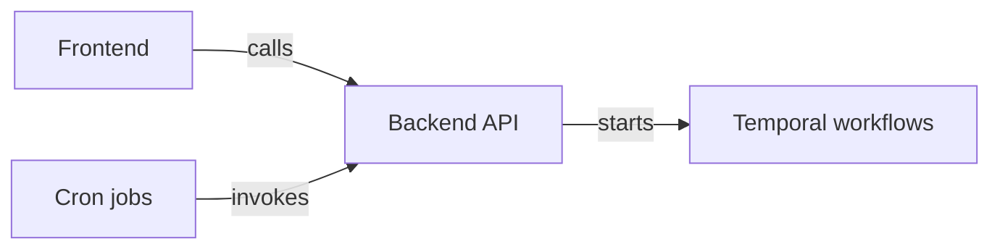

# Product and graph UX

Source: [original product plan](product-plan.md), especially [agreed direction](product-plan.md#2-agreed-product-direction), [graph design](product-plan.md#4-homepage-and-graph-design), [review intelligence](product-plan.md#6-review-intelligence), and [boundaries](product-plan.md#11-boundaries-and-success-measures). Status terms are defined in the [documentation index](README.md#how-to-interpret-status).

## Vision and agreed direction

**merge.foo is a personal productivity map for getting code reviewed, unblocked and merged.** It replaces a flat PR inbox with a map of dependencies and the attention needed next. Merging is the outcome; the first product helps a developer organize review and release while GitHub supplies code reading, comments and collaboration.

The agreed direction is one coherent diagram containing multiple independent stacks, PRs as the visible entities, restrained Linear-like polish, in-graph readiness and reviewer actions, planned reviews distinct from active requests, approval-driven progression, explicit holds and a per-stack automatic-progression control. Mermaid-like clarity is a visual direction, not a requirement to use Mermaid or a specific graph library.

The name `merge.foo` is chosen. On 2026-10-12 the user purchased the domain in Cloudflare; it now serves the existing application at `https://merge.foo`. “The shortest path to merged” remains a candidate tagline. See [domain configuration](domain.md).

### Primary user and job

The user clarified on **2026-10-12** that the current vision is a personal productivity tool for a developer delivering a complex feature across several PRs. Optimize for that developer's job: understand the full dependency network, choose planned reviewers using GitHub suggestions and stack context, release the next review at the right time, identify blockers and get the feature merged. The full repository network provides context for the individual's work. Using merge.foo should be useful independently, without requiring colleagues to adopt it.

This clarification sets the product focus. Current code stores planned assignments and workflow settings at installation/repository scope, allowing permitted collaborators to see or edit them. That is an implementation boundary, not a requirement for team coordination features. Before expanding planning, define which unpublished plans belong to the individual and which settings authorize real PR actions. Personal preferences belong to the GitHub user; review automation needs one durable record of effects on each managed PR. See [personal-first storage](hosting.md#personal-first-storage-direction).

Repository-wide visibility supplies context for this workflow. Read-only access is a consequence of GitHub access, not a separate target persona requiring dedicated onboarding or a new role system. Anyone can sign in; the experience emphasizes the individual's feature with full-repository context. GitHub remains authoritative for real actions. Plans use a PR-author or repository-write/maintain/admin edit rule, without separate teams or membership tiers. Durable hold editing and its release gate were verified in the scoped real pilot.

Normal users authorize the existing product GitHub App and choose an accessible repository. An administrator grants any missing installation access to that same App. Registration, credentials and hosting are operator responsibilities; developers never handle client secrets or setup scripts. Local/hosted sign-in and the scoped three-PR pilot are verified; another real user and complex repositories remain unverified. See [normal onboarding](setup.md#normal-user-onboarding), [operator recovery](setup.md#operator-setup-and-recovery) and [pilot limits](pilot.md).

## Five daily questions

| Question | Product target | Current implementation boundary |
| --- | --- | --- |
| What needs review today, and by whom? | Each stack's active review point, required decisions and assignment actions | Lab planned assignments and active requests are separate. The connected path renders observed requests, GitHub suggestions and persisted shared planned assignments. |
| How urgent is this work and what does it block? | Direct priority plus explained downstream importance | The panel shows downstream PR counts and urgent-work context. Fixtures use manual priority; live normalization uses an urgent/P0 label heuristic. Linked issue priority and richer urgency propagation are planned. |
| How complex is the review? | Raw LOC, explained effective LOC, summary, complexity and risk | Fixtures include disclosed estimates. Live LOC is unadjusted; complexity and risk are unassessed. There is no validated predictive score. |
| How long have I waited, and should I ping? | Actual request age, meaningful reviewer activity and separately recorded last ping | Request timestamps and unknown coverage are supported. Fixture activity illustrates author-turn context. There is no ping-sending action or cross-channel history integration. |
| What is this person's review load? | Active, upcoming, my requests sent in seven days, and recent completed reviews | Live active and planned/upcoming counts use loaded repository data and persisted plans. User-sent seven-day history is unavailable; none of these counts establish total availability. |

**Anyone should be able to sign in and use merge.foo independently.** On 2026-10-12 the user clarified that repository access should reveal the full PR network across authors, without a separate merge.foo teammate system. Repository visibility and actions follow available GitHub/App access. My work can filter the map to authored PRs and the reviewers a user is waiting on; it must not limit access to the repository map. The current implementation shares repository/stack settings and actor-attributed history using existing GitHub permissions; unpublished personal plan ownership remains to define. Separate team invitations and membership roles are outside the initial scope.

The user reaffirmed that each person should authorize their own repository choices. The public product provides a connection link even when the repository list is already populated, and refreshes that list when returning from GitHub installation/settings. GitHub supplies the personal/organization installation and consent flow, including administrator approval where needed. This does not grant arbitrary private access or activate review automation.

The connected reader paginates open PRs across all authors and includes matching recent merged ancestry. It fails closed beyond the open-PR safety limit and discloses the bounded historical/event coverage; it does not claim complete repository history.

## Work map contract

The user clarified on **2026-10-12** that the primary experience should feel like an interactive visualization with a few controls, closer to Google Maps than Gmail. The graph occupies the main viewport. The local prototype now uses a continuous full-window map, floating controls and temporary selected-PR details. The earlier sidebar and large-card presentation is retained only as comparison evidence.

Implemented prototype interaction model:

- Pan and zoom a continuous dependency map, with stable positions and a way to fit/focus the selected feature or stack.
- Use a small floating control group for repository selection, search, filters and optional layers, plus compact zoom/fit controls.
- Show compact PR markers/nodes with title/number, review state and reviewer cues. Reveal effort, history, reasons and actions on hover or selection instead of displaying every field/control at once.
- Selecting a node highlights its dependency path and opens a temporary detail card or drawer. Closing it restores the map view without losing location or selection context.
- Treat repository areas, reviewer context, workload and activity as contextual views/layers. Dedicated navigation pages should not be the primary way to understand a feature.
- Keep lab reset/reconciliation tools out of the ordinary map controls; fixture tools remain a separate exploration aid.

The prototype uses compact markers, floating search/filter/navigation controls and a temporary detail card (a bottom drawer on mobile). Repository-area layers remain future work, and visual refinement remains open to product review. Preserve accessible labels, keyboard navigation and a usable mobile selection/detail experience alongside pointer pan/zoom.

One canvas contains disconnected groups for independent stacks. An arrow **A → B means B depends on A**. Topology determines position; review state does not redefine the dependency. Left-to-right orientation is an adopted implementation proposal.

Linear chains use straight, aligned rows. Stack roots share a starting column, and matching dependency depths share columns with consistent spacing. Branches use separate lanes; decorative offsets must not make dependency structure harder to scan.

Use compact, consistent PR markers. Large changes should not create physically larger markers. Show number/title, review state and compact reviewer/wait/exception cues; expand coordination actions, effort/risk and history in selected details. Status remains understandable through text and shape as well as color.

Selecting a PR highlights upstream prerequisites and downstream dependents and opens temporary details, with a bottom drawer on mobile. Connected plans, holds, dependency corrections and explicit review previews use current permission checks. Actual effects require operator enablement and enrolled intent; the scoped pilot verified holds, progression and rollback. Repository maps open in My work, which hides other authors’ PRs and fits the remaining map; All stacks restores the full map. Refreshing preserves a chosen filter. Search and Needs attention preserve spatial context. The reader includes bounded recent merged ancestry and discloses its coverage.

Two-finger scrolling pans the canvas horizontally and vertically. Pinching zooms around the gesture position; touch pinches can move the canvas at the same time. Ctrl/Cmd-scroll also zooms. The lab verifies these interactions with nine PRs. Its layout is an HTML/CSS canvas with SVG connections and a topology-only layout function, not Mermaid. Branch siblings can occupy separate lanes; that rendering support is not validation of production branching automation.

### Planned assignments and reviewer continuity

On **2026-10-12**, the user chose **planned assignment**: select reviewers in merge.foo and hold back GitHub review requests until release. In the current implementation, repository readers can see the planned assignment. Suggestions are candidates with an explanation; accepting one creates the assignment. Assignment and release are separate actions, and assigning a reviewer does not notify them through GitHub.

The user also requested a bias toward the same human reviewer when adjacent stacked PRs modify the same code area, and then clarified that GitHub's suggestions should be used as much as possible. Start with GitHub's suggested candidates and returned order. Add stack-context explanations and an explicit continuity preference where warranted, rather than building a separate general reviewer-ranking engine. If a GitHub-suggested person actually reviewed the nearest relevant upstream PR, highlight the overlapping paths/module and link to that review. A person merely planned upstream can support consistency, but the UI must not claim completed review experience. Compare each PR's own changes against its base so inherited stack changes do not fabricate overlap.

Keep explicit assignments stable. Reviewer eligibility and applicable ownership/review requirements constrain the suggestion. A new area can warrant an additional specialist. Show observed review load as context, with its coverage limits; a context bias is not an automatic assignment or a new approval requirement. Prior approval of A does not approve B.

Example explanation: "Sam reviewed #142, which changed the same payment-cache module. B changes two of those files again." Separate declared code ownership, observed review context, GitHub suggestions and a person's explicit choice in the explanation; none alone proves total expertise or availability.

### Repository structure and reviewer explanations

The user requested diagrams that explain the repository's areas and why different reviewers are being selected: frontend, backend, scheduled jobs and Temporal workflows are examples, not a mandatory taxonomy for every repo.

Proposed design: link a repository map to the PR work map. Selecting a PR highlights touched areas; selecting an area highlights related PRs. For each area show relevant paths, known owners, planned/requested reviewers and the evidence for each recommendation. A reviewer-facing context panel should explain what changed, the PR's position in its stack and why that person's context is useful.

Start with configurable path-to-area mappings. Cron and Temporal can describe how background work executes within an area. Dependency/runtime arrows need source/configuration evidence or an explicit repository declaration; directory names alone do not prove that one component calls another. Label inferred, declared and unknown relationships, and expose incomplete file/history coverage. Use separate meanings for repository relationship arrows and A → B prerequisite arrows.

An illustrative repository map could show Frontend calling API, API starting a Temporal workflow, and a Cron job calling API:

For a selected PR, an example reviewer explanation could be "Sam reviewed the preceding PR's frontend changes" or "Jo is a declared owner of the changed API paths." This is a hypothetical example; no such architecture or ownership has been established for the connected repositories. The current implementation has no connected repository map or area-based suggestion engine.

### GitHub-native reviewer suggestions

GitHub exposes `PullRequest.suggestedReviewers` through GraphQL. Each suggestion identifies a reviewer and includes `isAuthor` and `isCommenter` flags for past commits and review comments. These are evidence categories, not a complete rationale, code-owner designation or approval requirement. Reading suggestions sends no review request. [GitHub GraphQL reference](https://docs.github.com/en/graphql/reference/pulls#suggestedreviewer)

**User-selected direction on 2026-10-12: GitHub suggestions are the primary recommendation source.** Fetch and display them first, retaining their returned order as the baseline without claiming an undocumented confidence score. Add context for continuity, declared ownership and covered workload; any change to the baseline should have a visible reason. Explicit assignments and actual eligibility/review requirements take precedence. Suggestions remain candidates until accepted as planned assignments, and requests still wait for release.

If suggestions are empty, unavailable or miss a required specialist, disclose that and allow explicit selection. A candidate supported by stack/ownership evidence must carry that separate source. The pilot verified GitHub's `ehfeng` suggestion on B/C and an empty suggestion list on A, with explicit persisted selection and no request on save. The reader preserves returned order; broader permission coverage and rich continuity/area/ownership analysis remain later work.

## Review intelligence proposals

Keep the following signals independent:

| Signal | Proposed meaning and disclosure |
| --- | --- |
| Raw LOC | Added plus deleted lines, with consistent counting |
| Effective LOC | Review volume after explicit, repository-configurable discounts; expose the rules |
| Complexity | Structural difficulty across components, interfaces and interactions |
| Risk | Consequence of a mistake, informed by affected areas and change type |
| Change summary | What changed and where attention is needed |

Generated, vendored, lockfile and formatting-only changes are candidates for disclosed discounts, not universal exclusions. Tests should not be silently discounted. The fixture calculation subtracts an explicit generated-line count and states that tests count in full. A production classifier and repository configuration are still planned.

Explain urgency using linked issue priority and downstream importance rather than stack length or an opaque score. Linear is a proposed source of linked context; issue nodes remain outside the PR-first MVP. On 2026-10-12 the user chose to ship the GitHub workflow first and add linked Linear priority afterward. No Linear connection is implemented in this repo.

Measure review waiting from an actual request, never PR creation or a planned assignment. Separate waiting on an author from waiting on a reviewer. Synchronization and mechanical updates should not reset the request clock. Ping context and any future user-triggered ping need explicit notification effects; unattended reminder campaigns are outside the initial scope.

Workload counts describe covered review requests, not total availability or performance. The current fixture counter lacks requester identity and assumes the mock workspace's request history; it cannot establish a production “sent by me” total. The live UI therefore labels that total unavailable.

## Boundaries and success

The initial product does not auto-merge code, replace the review editor, add issue nodes, or rank employees. Progressive release moves review attention; it does not establish mergeability or complete the merge.

Proposed success measures are time to first review, review-cycle waiting, avoidable re-review, assignment-to-release delay and time to merge, interpreted with repository context. These are product goals; telemetry and success measurement are not yet implemented.

Continue with the [progressive-review contract](progressive-review.md), [acceptance scenarios](acceptance.md), and [roadmap](roadmap.md).
